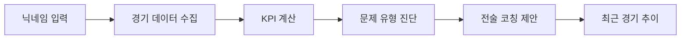
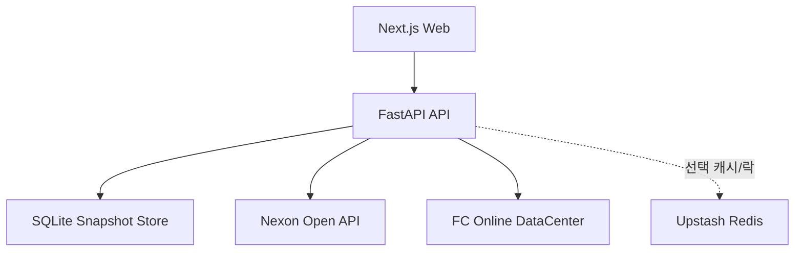

<div align="center">

# FCOACH

FC Online 최근 30경기를 팀·선수·경기별로 분석하고, 랭커 비교와 맞춤 코칭을 제공하는 서비스

[서비스](https://fcoach.fun) · [API Docs](https://fcoach-api.vercel.app/docs) · [GitHub](https://github.com/minzai0116/fcoach)

</div>

## 핵심 성과

- Nexon Open API와 FC Online DataCenter 데이터를 수집해 사용자 경기 데이터를 분석 가능한 형태로 정리했습니다.
- 데이터 수집, KPI 계산, 문제 진단, 액션 제안, FastAPI 분석 API, Next.js 웹 화면, Vercel 배포까지 직접 구현했습니다.
- `경기 분석 -> 맞춤 코칭 -> 최근 경기 추이`로 이어지는 서비스 경험을 설계했습니다.
- 실제 랭커 기록의 분포와 사용자 기록을 비교하고, 분석 스냅샷과 기능 완료·실패 이벤트를 기록합니다.

## 프로젝트 개요

| 항목 | 내용 |
| --- | --- |
| 한줄 요약 | 경기 로그를 분석해 플레이 문제와 개선 액션을 함께 제시하는 코칭 서비스 |
| 대상 도메인 | FC Online 경기 분석 |
| 핵심 가치 | 결과 지표를 보여주는 것에서 끝나지 않고, 다음 행동까지 제안 |
| 주요 데이터 | Nexon Open API, FC Online DataCenter |
| 서비스 구성 | Next.js 웹, FastAPI 분석 API, SQLite 기반 스냅샷 저장 |
| 배포 환경 | Vercel(Web/API) |

## 문제 해결 흐름

기존 전적 조회 서비스는 승률, 득점, 실점 같은 결과 지표를 잘 보여줍니다. 하지만 사용자가 다음 경기에서 무엇을 바꿔야 하는지까지 연결해 주는 경우는 많지 않습니다.

FCOACH는 이 문제를 해결하기 위해 최근 경기 데이터를 기반으로 문제 유형을 진단하고, 우선순위 액션과 검증 지표를 함께 제시합니다.



## 구현 범위

- 닉네임 기반 OUID 조회와 분석 실행 흐름 구현
- 공식경기·공식 친선을 합친 최근 30경기 분석, 몰수승·몰수패 기본 포함
- 최근 경기 등록 포지션의 포메이션에서 같은 자리 출전 선수를 바꿔 보고 시즌·강화별 기록 확인
- 팀 패스 종류별 성공률·사용 비중, 슈팅 종류·위치, 수비·드리블·경합 시각화
- 닉네임의 공개 스쿼드 피드에서 저장된 전술·특성·훈련코치 연결
- 피드의 미니페이스온과 기본·획득 신규 특성 표시, 특성의 저장 강화 출처 구분
- 실제 랭커 평균·분포를 기준으로 영역 점수와 세부 기록 비교, 강점·보완점별 플레이 제안
- 경기별 상대 기록·공개 순위·역대 최고 등급 확인
- 시즌·강화·포지션별 두 선수의 경기당 기록·성공률 비교, 선수·유형별 슈팅 지도 필터
- 최근 경기마다 최대 30경기 이동 집계로 기록 변화를 시각화
- PC의 포메이션·상세 정보 2분할, 모바일의 선수 선택·상세 보기·뒤로가기
- 클릭, 탭, 실행 이벤트 기록을 통한 운영 지표 추적

## 시스템 구조



- Web은 분석 요청과 결과 렌더링을 담당합니다.
- API는 외부 데이터를 수집하고 정규화한 뒤 분석 결과·랭커 평균·영역 점수와 최근 경기 추이를 생성합니다.
- 저장 계층은 스냅샷, 실험 기록, 이벤트 로그를 관리합니다.
- Redis는 선택 구성으로, Vercel 인스턴스 간 캐시와 중복 요청 방지 락을 공유합니다.
- 읽기 경로와 동기화 경로를 분리해 사용자 체감 지연을 줄였습니다.

## 기술 스택

- 웹: `Next.js 15`, `React 19`, `TypeScript`
- API: `FastAPI`, `Pydantic`
- DB: `SQLite`
- Cache: `Redis` 선택 구성
- 데이터: `Nexon Open API`, `FC Online DataCenter`
- 배포: `Vercel`

## 로컬 실행

```bash
git clone https://github.com/minzai0116/fcoach.git
cd fcoach
cp .env.example .env
cp apps/web/.env.example apps/web/.env.local
make init
make init-db
```

필수 환경 변수:

```bash
NEXON_OPEN_API_KEY=YOUR_NEXON_OPEN_API_KEY
# 선택: Vercel 다중 인스턴스 캐시/락 공유
REDIS_URL=rediss://...
```

`apps/web/.env.local`:

```bash
NEXT_PUBLIC_API_BASE_URL=http://127.0.0.1:8000
```

실행:

```bash
make api
cd apps/web && npm install && npm run dev
```

## 주요 API

- `GET /users/search?nickname=...`
- `POST /analysis/run`
- `GET /matches/recent`
- `GET /matches/{match_id}/review`
- `GET /squad-feeds?nickname=...`
- `GET /squad-feeds/{feed_id}`
- `POST /analysis/compare`
- `GET /analysis/latest?ouid=...&match_type=52&window=30`
- `GET /actions/latest?ouid=...&match_type=52&window=30`
- `POST /experiments`, `GET /experiments/evaluation`은 구버전 호환 API입니다. 현재 개선 추적 화면에서는 사용하지 않습니다.

## 업데이트

- [2026-10-27~28 통합 패치노트](docs/releases/2026-10-28.md) · [게시용 짧은 버전](docs/releases/2026-10-28.txt)
- [2026-10-22 패치노트](docs/releases/2026-10-22.md)
- [넥슨 Open API 게시용 글](docs/promo/2026-10-22/nexon-openapi-post.md)
- [커뮤니티 홍보 글](docs/promo/2026-10-22/community-post.md)

공개 피드는 저장된 설정이며, 과거 경기에서 사용한 설정인지나 특성·코치 발동 여부를 확인하는 기능은 아닙니다. 전진 패스 방향처럼 API가 제공하지 않는 값은 추정해서 표시하지 않습니다. 전후 수치 변화도 설정 변경의 인과 효과로 단정하지 않습니다.

## 배포 및 한계

- 현재 공개 서비스는 `Vercel(Web/API)` 기준의 데모 배포입니다.
- API가 serverless 환경에서 로컬 SQLite를 사용하므로 스냅샷, 실험 기록, 이벤트 로그는 지속 저장되지 않습니다.
- 장기 운영 기준에서는 관리형 DB 또는 persistent volume이 있는 환경으로 전환이 필요합니다.
- 자세한 배포 절차는 [docs/DEPLOYMENT.md](docs/DEPLOYMENT.md)에 정리했습니다.

## 데이터 보관 정책

- Nexon Open API 및 FC Online DataCenter에서 가져온 원천 데이터는 최대 30일 이내 데이터만 저장·조회합니다.
- 대상은 경기 원본(`matches_raw`), 닉네임 조회 캐시(`user_lookup_cache`), 공식 랭커 원천 데이터(`official_rankers`)입니다.
- `NEXON_API_DATA_TTL_DAYS` 기본값은 30이며, 정책 준수를 위해 30일을 초과하지 않도록 제한합니다.
- 서비스 이용 로그와 실험 기록은 Open API 원천 데이터가 아니므로 별도 운영 데이터로 관리합니다.

## 라이선스 및 고지

- 소스코드 라이선스: MIT ([LICENSE](LICENSE))
- FC Online 관련 데이터, 상표, 이미지 권리는 각 권리자에게 있습니다.
- 본 프로젝트는 비공식 팬 프로젝트이자 포트폴리오 용도로 제작했습니다.
