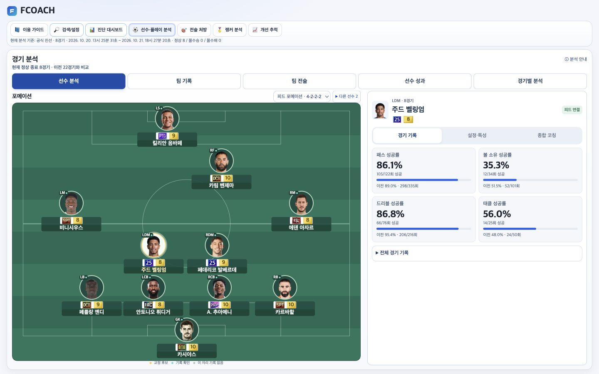
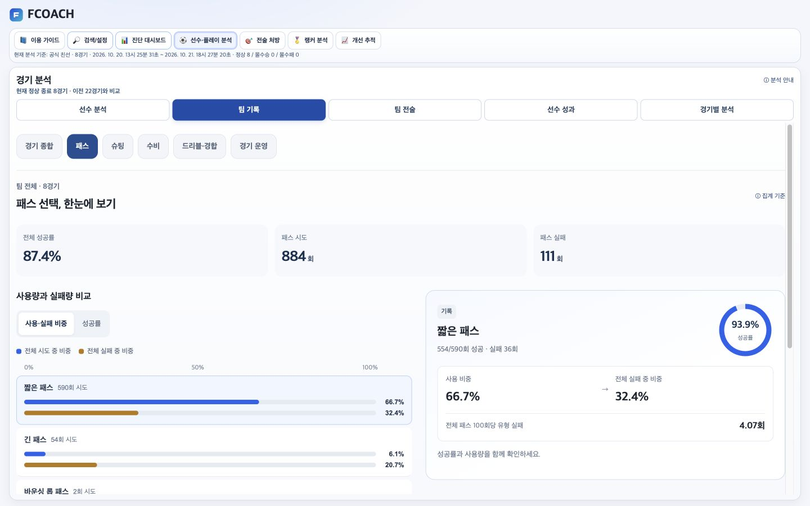
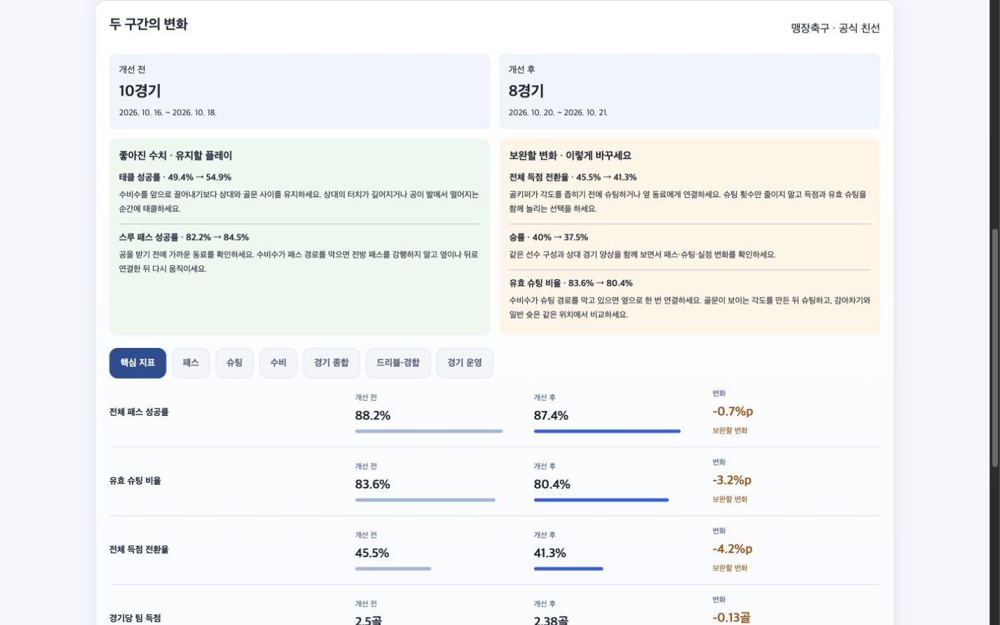
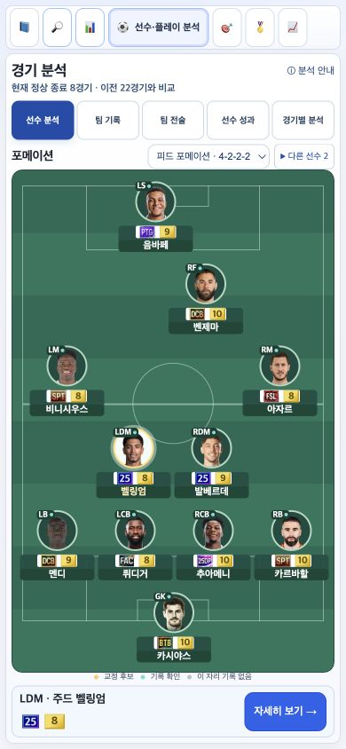

# FCOACH 업데이트: 선수별 코칭·공개 스쿼드 연결·경기 전후 비교

안녕하세요. FC온라인 경기 기록 분석 서비스 **FCOACH**를 업데이트했습니다.

**서비스 바로가기: https://fcoach.fun**

이번에는 기록을 읽는 과정과 실제로 바꿔볼 플레이를 찾는 흐름을 중심으로 개선했습니다.

### 1. 포메이션에서 선수별 기록 확인

경기장 위 선수를 선택하면 해당 시즌·강화·포지션의 기록과 코칭을 볼 수 있습니다. 골키퍼는 선방·배급 등 역할에 맞는 지표를 제공합니다. PC에서는 좌우 화면으로, 모바일에서는 선수 선택 후 상세 보기로 확인합니다.

### 2. 공개 스쿼드의 설정 연결

닉네임의 공식 스쿼드메이커 공개 피드 하나를 선택하면 저장된 전술·특성·훈련코치와 경기 기록을 함께 볼 수 있습니다. 특성과 훈련코치는 아이콘으로 표시합니다. 피드와 경기의 선수·강화·자리가 다르거나 제공되지 않은 값은 구분합니다.

### 3. 패스·슈팅·수비 세부 분석

패스 종류별 성공률과 사용·실패 비중, 슈팅 종류·위치, 태클·블록·드리블·경합 기록을 나눠 보여줍니다. 슈팅 점을 선택하면 누가 언제 슈팅했는지도 확인할 수 있습니다. 현재 수치와 이전 경기 대비 변화를 구분해 플레이 선택지를 제안합니다.

### 4. 원하는 경기로 개선 전후 비교

분석 시작·종료 경기를 직접 고르고, 개선 추적에서는 비교할 경기를 ‘개선 전’과 ‘개선 후’로 나눕니다. 경기 수가 달라도 경기당 평균과 성공 합계/시도 합계로 비교하며, 수치 변화와 유지·보완할 플레이를 함께 보여줍니다.

### 5. 모바일과 조회 안내 개선

포메이션의 시즌·강화 표시와 선수 상세 이동을 다듬었습니다. 없는 닉네임, 해당 모드의 경기 내역 없음, 조회 실패도 구분해서 안내합니다.

경기 데이터는 **Nexon Open API**, 스쿼드 설정과 랭킹은 **FC온라인 공식 홈페이지의 공개 정보**를 활용합니다. 공개 피드는 저장된 설정이며 경기 당시 사용 여부나 특성·코치 발동을 확인하는 기능은 아닙니다. API에 없는 전진 패스 방향은 추정하지 않으며, 전후 수치 변화만으로 전술이나 코치의 효과를 단정하지 않습니다.

직접 사용해보시고 이해하기 어려운 지표나 불편한 화면이 있다면 의견 부탁드립니다.

감사합니다.

※ 넥슨의 공식 서비스가 아닌 개인 개발 서비스입니다. API 반영 시점·점검·호출 제한에 따라 조회 가능한 기록이 달라질 수 있습니다.
